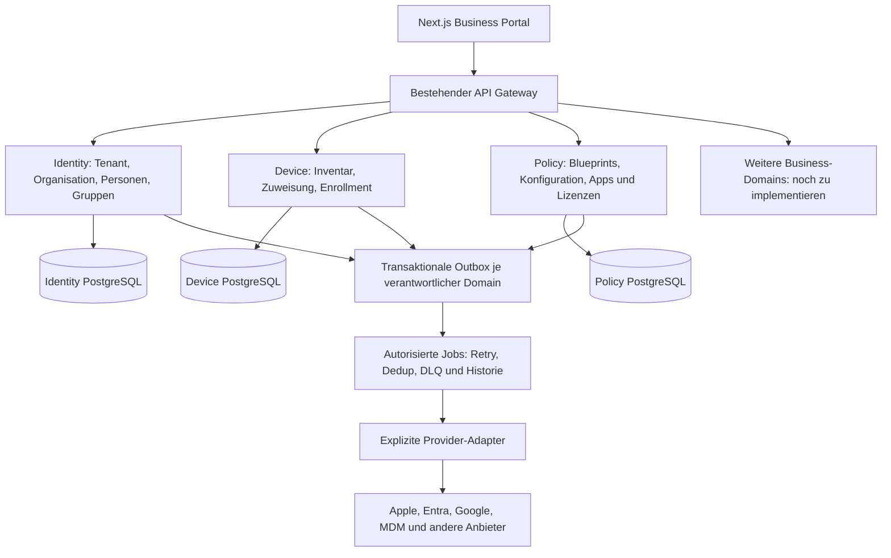

# Zielarchitektur und vorhandene Laufzeit

## Entscheidung

OpenDirectory wird weiterentwickelt, nicht parallel neu gebaut. Vorhanden sind Next.js/React/TypeScript, Node.js/Express-Dienste, PostgreSQL, Redis, Broker-/Event-Bus-Komponenten und Compose-/Deployment-Dateien. Der optionale Laravel-/Vite-Stack aus dem Master-Prompt greift nur bei einem neuen Projekt und wird hier nicht eingeführt.

Die vorhandenen Microservices werden nicht ohne konkreten Nutzen in einen neuen Monolithen migriert. Neue Business-Funktionen werden zunächst als fachlich geschlossene Module in der bestehenden Laufzeit implementiert. Ein weiterer Service benötigt eine belegte unabhängige Skalierungs-, Sicherheits- oder Deployment-Anforderung.

Das Diagramm enthält Zielkomponenten. Insbesondere ein universeller Job-/Outbox-Delivery-Dienst und zusätzliche Business-Domains sind nicht allein dadurch implementiert.

## Datenhoheit

| Domain | Vorhandener Einstieg | Ausbaugrenze |
| --- | --- | --- |
| Tenant/Identity | `services/core/identity-service/src/index.js`, `migrations/024_tenant_ownership.sql`, `037_organization_profiles.sql`, `038_organization_delegations.sql`, `039_company_registrations.sql` | Ein kanonischer Tenant und Benutzer; keine zweite Identitätsdatenbank im Business-Portal. Firmenprofil, begrenzte Profildelegation und credentialgebundene öffentliche Pending-Registrierung sind implementiert; tatsächliche Freigabe, eigener Company-Owner/Console-Zugriff und vollständige Organisations-Governance fehlen noch. |
| SSO/Clients | `services/core/oauth-provider` | Bestehende OIDC-/Client-/Session-Verträge nutzen. Prototypische und persistente Pfade nicht als gleichwertige Autorität behandeln. |
| Geräte | `services/core/device-service` | Ein Inventar und historisierte Zuweisungen; vorhandene Legacy-Remote-Aktionen sind keine akzeptierte Apple-MDM-Integration. |
| Richtlinien/Blueprints | `services/core/policy-service`, `BlueprintConfigurationView.tsx` | Bestehende Konfigurations-/Freigabe-/Command-Verträge erweitern; gewünschte, angenommene und tatsächlich beobachtete Konfiguration unterscheiden. |
| Apps/Lizenzen | `services/core/policy-service`, `LicenseKioskView.tsx` | Kanonische lokale Allokation wiederverwenden. Herstellerbereitschaft und lokale Entitlements bleiben getrennt. |
| Standorte/Marketing/Finance/Support | Kein vollständig abgenommener kanonischer Business-Prozess | Keine Browser-Arrays, Standort-Dummies oder Prototype-Controller zur Produktivautorität erklären. |

## Verbindliche Grenzen

- Tenant und ursprünglicher Actor kommen aus der überprüften Session und kanonischen Bindung, nicht aus frei wählbaren Request-IDs.
- FK-/Versions-/Tenant-Bindung, konkurrierende Änderungen und autorisierte Zustandsübergänge werden serverseitig geprüft.
- Fachliche Änderung und notwendige Audit-/Outbox-Einträge werden gemeinsam committed. Zustellung ist ein eigener, nachweisbarer Vorgang.
- Über Service-Grenzen gibt es keine erfundene globale Datenbanktransaktion. Ein Workflow speichert Fortschritt, Teilfehler und erlaubte Wiederaufnahme.
- API-Kontrakte umfassen Fehlercode, Request-/Correlation-ID, Pagination, Version/ETag und bei kritischen Operationen persistente Idempotenz.
- Neue Versionen öffentlicher APIs werden nur zusammen mit dem tatsächlich erreichbaren Receiver und seinen Tests dokumentiert. Ein OpenAPI-Entwurf ist kein implementierter Endpunkt.

## Noch keine SaaS-Freigabe

Die aktuellen eigenen Tenant-/User-/Group-Grenzen sind Teilimplementierungen. Globale Rollen-/Policy-Autorität, andere Ressourcen, ursprüngliche Receiver und Console-Cutover haben [bekannte offene Punkte](../features/identity-governance.md#fifty-second-increment-in-progress-tenant-bound-authority-lifecycle). Die neuen versiegelten SQL-Quellen bis Migration 036 sind nicht aktiv. Shared-Customer-Hosting, allgemeine Least-Privilege-Defaults und ein öffentliches Self-Service-Onboarding sind damit nicht als sicher oder fertig nachgewiesen.

## Erster vertikaler Business-Slice und nächster Prozess

Das [Organisationsprofil](../features/organization-profile.md) ist als persistenter Read/Update-Slice mit eigener Version, tenantgebundener API, Formular, MFA, Audit/Outbox und echten SQL-/Signed-/Browser-Nachweisen umgesetzt. Die [begrenzte Profildelegation](../features/organization-delegations.md) erlaubt normalen eigenen Benutzern diese eine fachliche Aufgabe ohne globale Adminrolle; sie ist noch keine vollständige Company-Administration. [Teilmodell](domain-model.md) und [ERD](erd.md) beschreiben nur die tatsächlichen Tabellen. Als Nächstes folgt Registrierung/Erstadministrator als eigener End-to-End-Prozess, kein öffentlicher Endpunkt, der heimlich eine globale Administratorrolle erzeugt. Die koordinierte aktive eigene Rollenquelle und vollständige Receiving-Governance bleiben verpflichtende Identity-Arbeit.

Die [öffentliche Registrierung zur Prüfung](../features/company-registration.md) implementiert den ersten Teil von WF-001: existierende Provider-Credentials → eigener kurzlebiger Issuer-Workload → neue deaktivierte kanonische Tenant-/User-Komponente und immutable Pending-Belege. Die [interne Firmenprüfung](../features/company-registration-reviews.md) ergänzt eine explizit bestellte, eng begrenzte Plattformfähigkeit, echte Queue und immutable Freigabe/Ablehnung. Anschliessend ermöglicht die [eigene Aktivierung](../features/company-activation.md) Initialprofil, dauerhaften begrenzten Owner, eine konfigurierte Console und echte Pflicht-MFA-/Owner-Anmeldung. Die allgemeine 62-Rollen-/Schema-6-Quelle wird nicht durch ein neues globales Rollenwort ersetzt; vollständige Company-Administration und aktive eigene allgemeine Rollenquelle bleiben offen.
