# ERD: tatsächlich implementiertes Organisationsprofil

Nur das persistente Teilmodell der Migrationen 037–039 und seine existierenden Tenant-/Checkpoint-/Proof-Grenzen. Nicht das vollständige künftige SaaS-Modell.

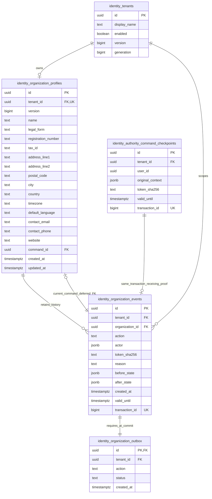

Die Checkpoint-Kante ist eine deferred geprüfte Transaktions-/Actor-/Token-Beziehung, kein deklarierter Foreign Key zwischen diesen beiden Tabellen. Die exakt eine Pending-Outbox wird zusätzlich zum FK bei Receiving/Commit verlangt. Versionen und Generationen bleiben nach aussen bigint-Strings.

## Begrenzte Profildelegation

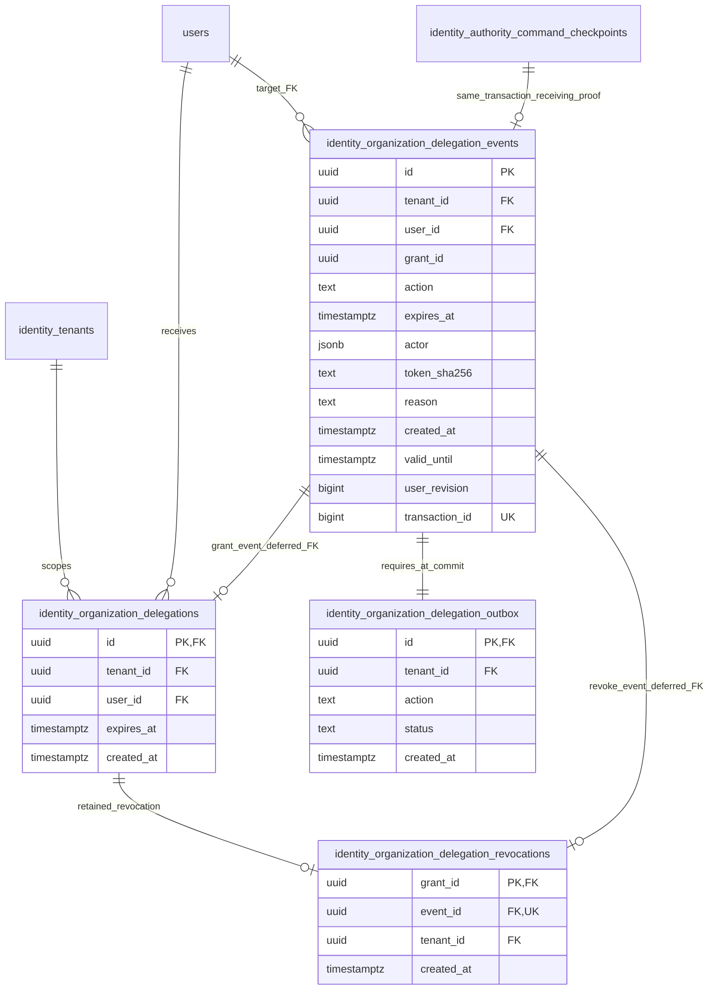

`event.grant_id` wird durch den tatsächlichen Befehls-/Commit-Beleg an den Grant gebunden, nicht als deklarierter FK ausgegeben. Die Checkpoint-Kante ist ebenfalls eine tatsächliche deferred Receiving-Prüfung. Die User-FKs behalten das Ziel; Original-Actors sind gebundene historische JSON-Nachweise, keine erneut verwendbaren Rollen. Die Autorisierungsinvalidierung erfolgt an der vorhandenen kanonischen User-Zeile im selben Commit.

## Pending-Registrierung

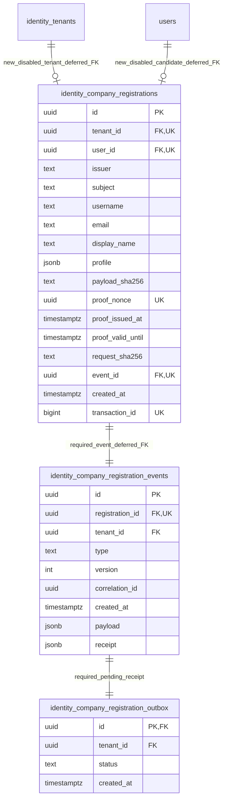

Issuer/Subject ist zusätzlich gemeinsam eindeutig. Der private kurzlebige Issuer-Workload ist kein aktiver Human-Checkpoint oder Anwendungs-Access-Token. Seine tatsächliche noch gültige Admission bindet nur die neue deaktivierte Komponente und die ursprüngliche Commit-Frist; gespeicherte Credentials oder eine globale Adminrolle existieren in diesen Tabellen nicht. Die Correlation-ID entspricht dem unveränderlichen Request-Key.

## Interne Firmenprüfung: Migration 040

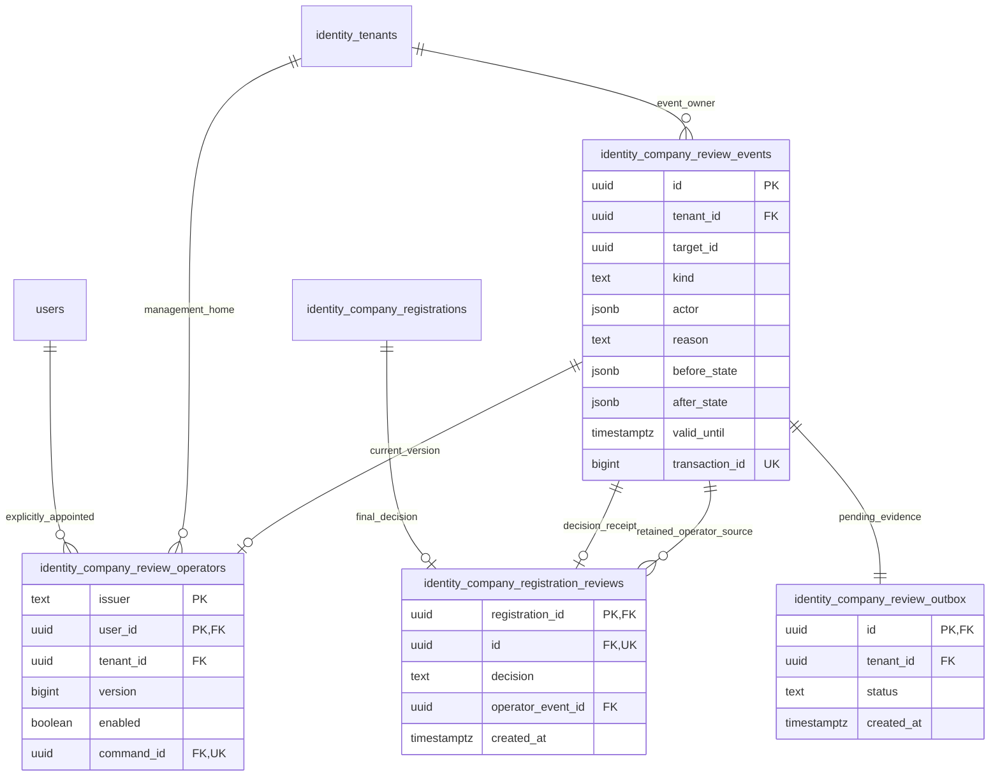

Das Ereignis eines Offline-Operatorbefehls gehört zum Management-Tenant, das einer Antragsentscheidung zum Ziel-Tenant. Letzteres besitzt zusätzlich den Original-Checkpoint des Management-Tenants. `target_id` ist ein typisierter Ereignisbezug auf User oder Antrag, kein polymorpher SQL-FK; die konkreten Root-Tabellen besitzen die tatsächlichen FKs. Reguläre API-Benutzer können das Register nicht ändern und keine historischen Reviews löschen. Personenbezogene FKs und Audits benötigen weiterhin kontrollierte Retention-/Löschregeln; keine physische Sofortlöschung oder bereits fertige Compliance-Archivierung wird behauptet.

## Eigene Firmenaktivierung: Migration 041

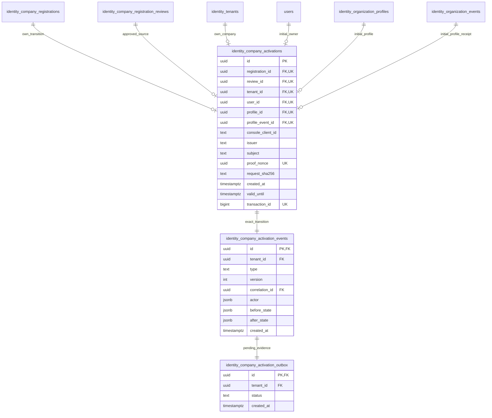

Der Aktivierungsdatensatz ist der unveränderliche ursprüngliche Owner-Source, kein allgemeines Rollen-/Mitgliedschaftsregister. Der Profil-FK ist zusätzlich zusammengesetzt mit dem Tenant. Der Console-Client gehört zur separaten Issuer-Datenbank; es wird kein unmöglicher datenbankübergreifender FK behauptet. Die private aktuelle Owner-Abfrage prüft Bindung und Berechtigung vor der tatsächlichen Console-Nutzung. Audit-/Outbox-Retention und kontrollierte spätere Lösch-/Owner-Übertragungsprozesse bleiben erforderlich.

## Kanonische Organisationseinheiten: Migration 042

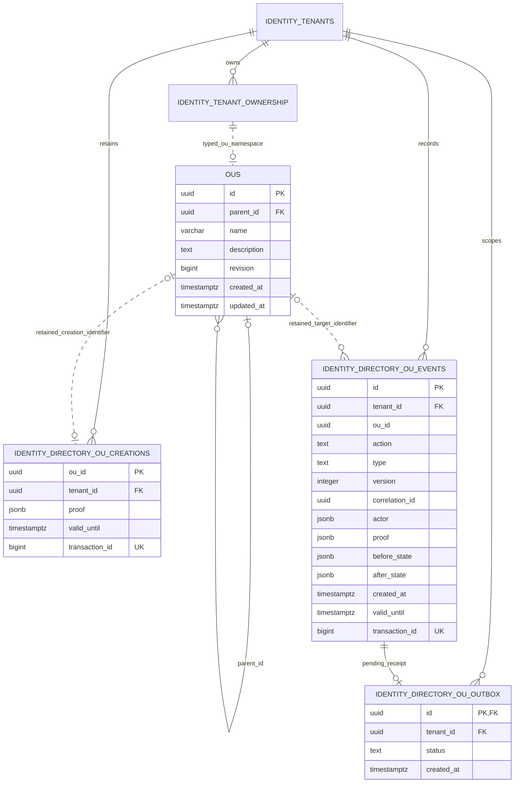

Gestrichelte OU-Beziehungen sind Identifier-/Namespace-Beziehungen, keine behaupteten FKs auf eine nach Retirement noch vorhandene OU-Zeile. Der unveränderliche `resource_kind=ou`-/`resource_id`-Namespace bestimmt die tatsächliche Tenant-Hoheit. Der bestehende Parent-FK bleibt erhalten; kanonische Löschungen verweigern Kinder statt dessen Legacy-`SET NULL` als Business-Workflow zu benutzen. Die neuen Tabellen behalten ihre Tenant-FKs und eigene Outbox-/Event-FK-Bindung. Für jeden erfolgreichen neuen Mutationsevent ist die Pending-Outbox am Commit zwingend, nicht bloss optionales Best Effort.

Bestehende OUs erhalten eine Anfangsrevision ohne erfundene rückwirkende Historie; deshalb muss nicht jeder Legacy-Datensatz eine neue Creation-Admission besitzen. Neue ursprüngliche Erstellungen halten ihren vollständigen Proof bereits vor dem Namespace-Write. Creation-/Mutation-Origin, Ownership und negatives Retirement werden nicht durch Row-Löschung entfernt. Kontrollierte Datenschutzlöschung, Retention und Off-host-Aufbewahrung sind weiterhin offene Betriebsanforderungen.

## Mehrfache Benutzer-OU-Zuordnungen: Migration 043

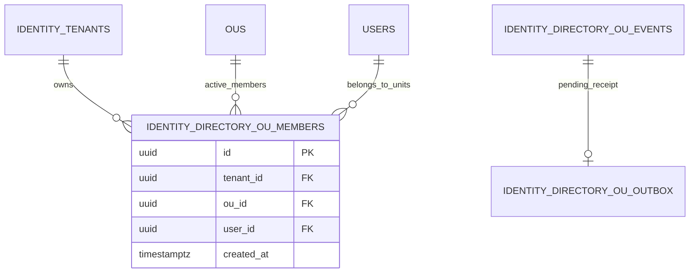

OU/User ist zusätzlich eindeutig. Eine Person besitzt null bis viele aktive Zuordnungen; jede Beziehung gehört exakt einem Tenant, einer OU und einem User. Tatsächliche kanonische Hoheit aller drei Ziele wird beim Schreiben und Lesen geprüft, nicht aus unabhängigen FKs vermutet. Aktive OU-/User-FKs verwenden `RESTRICT`; lokale Ziel-Löschung ist bis zum ausdrücklichen Unlink ausgeschlossen. Seitenindex `(tenant_id,ou_id,created_at,id)`, Benutzerabhängigkeitsindex `(user_id,ou_id)` und der Index auf historischen Membership-IDs unterstützen diese Verträge.

`member-add`/`member-remove` verwenden dieselben OU-Events und Pending-Outbox aus 042. Der genaue aktive Datensatz bzw. ursprüngliche Before-Datensatz liegt in `proof.target.member`; jede Änderung erhöht die OU-Revision. Nach Unlink verschwindet nur die aktive Relation, nicht das historische Ereignis. Historische Events besitzen keinen FK auf später entfernte User-/OU-Rows; erneutes Zuordnen erzeugt eine frische UUID. Kein zweites Department-/Rollenregister, keine implizite Lizenzvergabe und kein als gelöst behaupteter Datenschutz-/Aufbewahrungsprozess. Siehe [vollständigen begrenzten Vertrag](../features/organization-memberships.md).

## Geräteinventar: Device-Migration 005

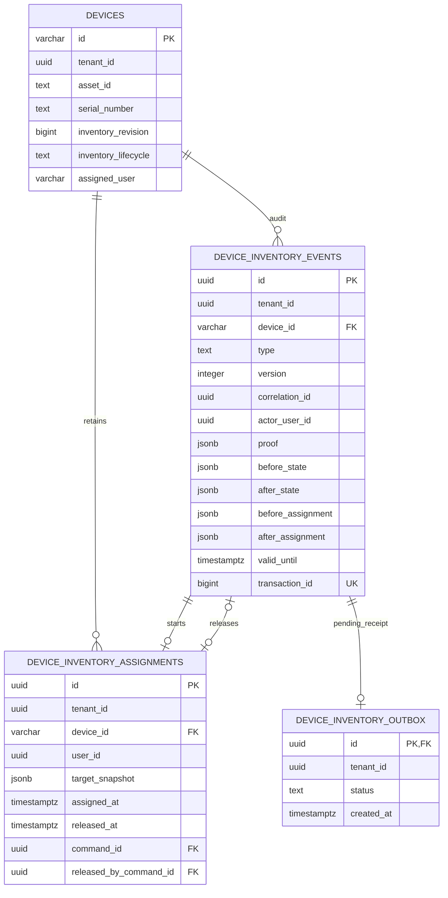

Dies ist die **separate Device-Datenbank**. Tenant/User/Actor-IDs sind geprüfte kanonische Referenzen mit damaligem Identity-Snapshot, keine behaupteten Cross-Database-FKs. `UNIQUE(device_id) WHERE released_at IS NULL` erlaubt genau eine aktuelle exklusive Zuweisung; die frühere wird bei Wechsel atomar geschlossen. Inventar-/Seriennummer sind je Tenant case-insensitiv eindeutig. Page-/History-/Recipient-Indizes dienen den wirklichen serverseitigen Abfragen. Im Erfolg muss jedes neue Event am Commit seine gleichnamige Pending-Outbox besitzen; der Creator-FK ist für Admission vor Device-Insert deferred.

Aktuelle Geräte und Historie werden in diesem Slice nicht über einen Delete-Endpunkt gelöscht; Raw-Delete/Truncate ist geschützt. Datenschutz-/Retention-/Archivierung ist weiterhin offen. Historische unowned Geräte bleiben bestehen und unsichtbar bis zu einem späteren ausdrücklich überprüften Adoptionsprozess. Es gibt keine automatische MDM-/Lizenzhoheit aus diesen Beziehungen; [Grenzen und Rollout](../features/device-inventory.md).

## Lizenz-Benutzerquellen: Migration 044

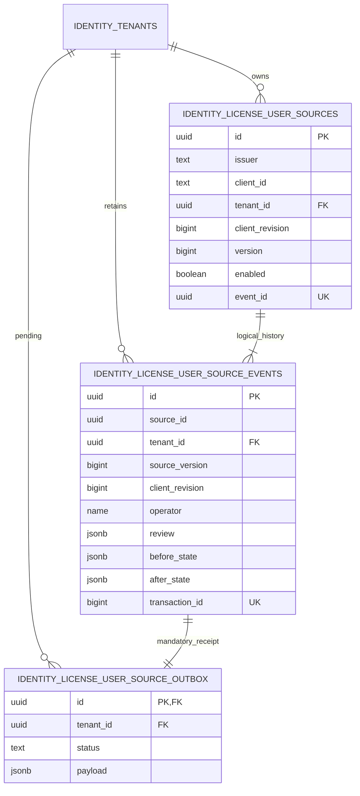

Eine Source gehört genau einem bestehenden Tenant; `(issuer,client_id)` und `(source_id,source_version)` sind eindeutig. Die Source/Event-Beziehung ist ein durch Receiving-/Commit-Proof erzwungener logischer Vertrag, kein deklarierter Event→Source-FK: der ursprüngliche Event wird vor der neuen Source geschrieben. Das aktuelle `event_id` ist eindeutig, ebenfalls proofgebunden. Die Outbox besitzt einen echten FK zum Event; der vollständige Commit verlangt genau eine passende Pending-Receipt. Aktuelle State-Version und sämtliche JSON-Revisionswerte bleiben exakt als BIGINT-Strings erhalten.

Der getrennte Issuer bleibt Hoheit für Clientstatus/-revision. Es gibt keinen Cross-DB-FK, keinen Default-Tenant und keine automatische Bindung anhand eines Benutzers. Tenant-/Issuer-/Client-Herkunft bleibt unveränderlich, Clientrevision nur bewusst monoton aktualisierbar. Deaktivierung behält alle Belege; gewöhnliche Löschung/Truncate konfigurierter Quellen ist nicht erlaubt. Kontrollierte Datenschutz-/Retention-Verfahren und unabhängige Aufbewahrung bleiben offen. [API-/Operator-Vertrag](../features/tenant-license-sources.md).

## Firmen-Lizenzinventar: Policy-Migration 022

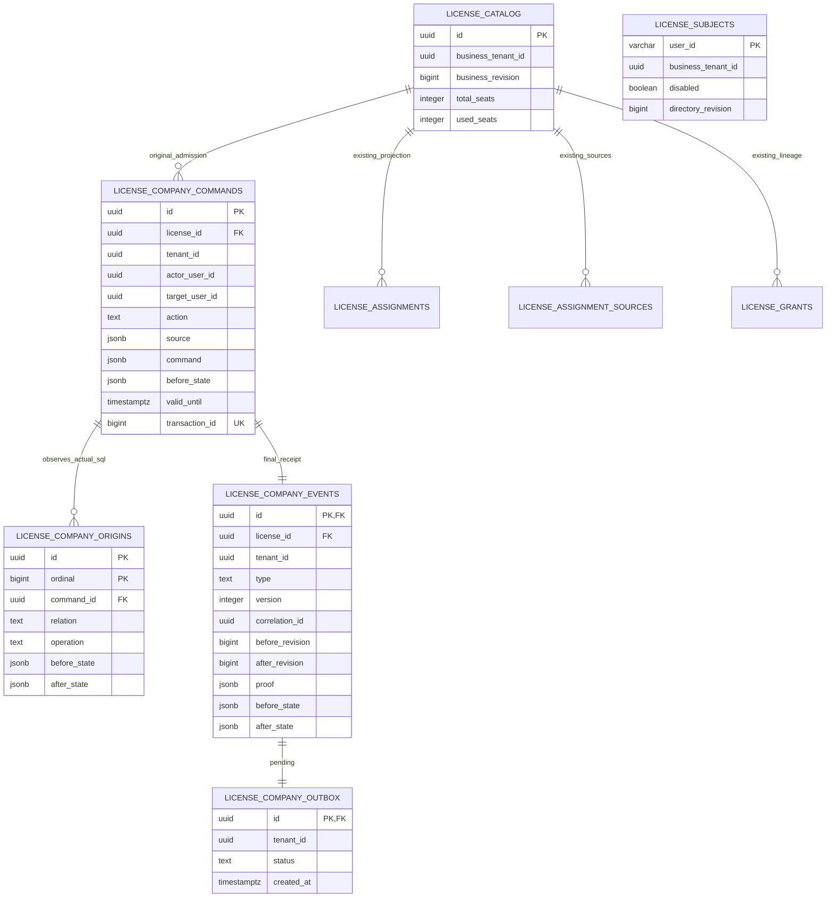

Dies sind additive Felder/Tabellen der bestehenden **Policy-Datenbank**, kein zweites Lizenzsystem. Ein Pool hat null bis viele ursprüngliche Commands; jeder erfolgreich committed Command benötigt genau ein passendes finales Event und eine Pending-Outbox. Der Pool-FK am Command ist für Admission vor neuem Pool-Insert deferred; Event-/Outbox- und Effect-FKs sind real. `(license_id,after_revision)` und SQL-Transaktion sind eindeutig. Page-Indizes unterstützen echte Tenant-/Pool-/Historienabfragen.

Tenant und menschliche IDs besitzen hier bewusst keinen Cross-DB-FK zur Identity-Datenbank. Quelle und unveränderlicher Namespace werden vor/nach der Operation aktuell geprüft. Beide Ownership-Felder bleiben bei Legacy-Rows NULL; vorhandene Rechte-/Directory-/Providerhistorie wird nicht als leere neue Firma adoptiert. Raw-Löschung/Truncate aktueller Firmenbestände und Belege ist geschützt; kontrollierte Privacy-/Retention-Verfahren sind noch offen. [Vollständiger begrenzter Vertrag](../features/company-licenses.md).

## App- und Bestandskorrekturen: Policy 024

Policy **024** ergänzt am oben dargestellten Katalogmodell nur `update`-Commands und `app.license.pool.updated`-Events mit bestehender Original-Effect-/Pending-Kette. Kardinalitäten und Tabellen bleiben unverändert; kein neues Lizenzmodell und keine neue Benutzerzuweisung. Katalog-/Bestandsänderung erfolgt mit genau einer neuen Revision und unverändertem Namespace/Belegungsbestand. [Vertrag](../features/company-licenses.md#app--und-bestandskorrekturen).

## Dauerhaftes lokales Offboarding: Identity 045 und Policy 023

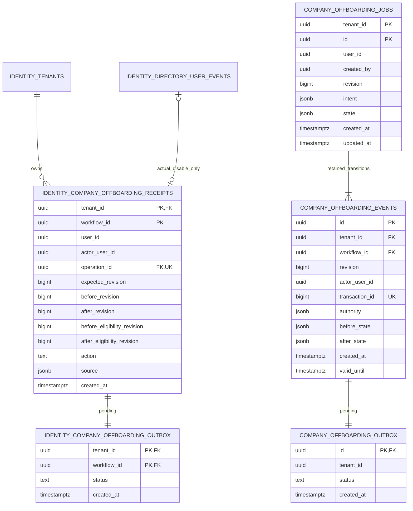

Erste drei Tabellen: nur Identity; letzte drei: nur Policy. Keine gezeichnete Cross-DB-FK- oder Atomaritätsbehauptung: der Identity-Checkpoint im Job wird über den ursprünglichen menschlichen Vertrag geprüft. Ein Tenant/Vorgang besitzt genau einen Identity-Beleg, jede reale Sperre höchstens einen referenzierten Directory-Event und jeder erfolgreich angelegte Policy-Job mindestens ein retained Event. `(tenant_id,workflow_id,revision)` ist im Journal eindeutig. Beide Outbox-Typen bleiben tatsächlich `pending`.

Die interne Identity-Tabelle `identity_company_offboarding_commit_checks` besitzt Transaktionsschlüssel und ursprünglichen Source-Proof; sie ist physischer Commit-Guard, keine zusätzliche Business-Entity. Lizenz-Assignment/-Grant/-Release-Belege bleiben im bestehenden Modell von Migration 022. Retention-/Löschbetrieb und vollständiges WF-004 sind offen. [Vertrag](../features/company-offboarding.md).

## Gruppenentzug beim Austritt: Identity 046

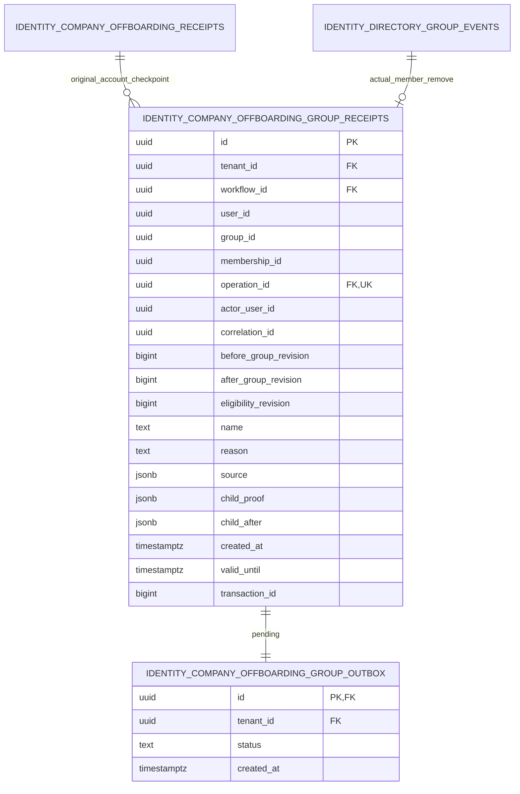

Alle dargestellten Tabellen gehören Identity; kein neuer Cross-DB-FK oder zweites Gruppenverzeichnis. Der Parent-FK ist zusammengesetzt aus Tenant/Vorgang; User-/Gruppen-/Membership-/Source-Kohärenz prüft der kanonische SQL-Vertrag. Kein FK zur gelöschten Live-Mitgliedschaft: Original-Child-Event, retained Membership-Origin und Before-/After-Belege tragen ihre Identität weiter. Ein Account-Checkpoint hat null bis viele erfolgreiche Gruppen-Children, jedes neue Child genau einen echten Group-Event und eine zwingende Pending-Outbox. Ein normaler Group-Event muss umgekehrt kein Offboarding-Child sein.

Zusätzlich besitzt `identity_company_offboarding_group_checks` einen Transaktionsschlüssel mit ursprünglichem Proof als internen Commit-Guard. Normale Änderungen/Löschung/Truncate dürfen die retained Kette nicht entfernen; kontrollierte Retention/Privacy bleibt offen. [Ausführbarer begrenzter Vertrag](../features/company-offboarding.md#gruppen-beim-austritt-entfernen).

## Rollen-PIM-Entzug beim Austritt: Identity 047

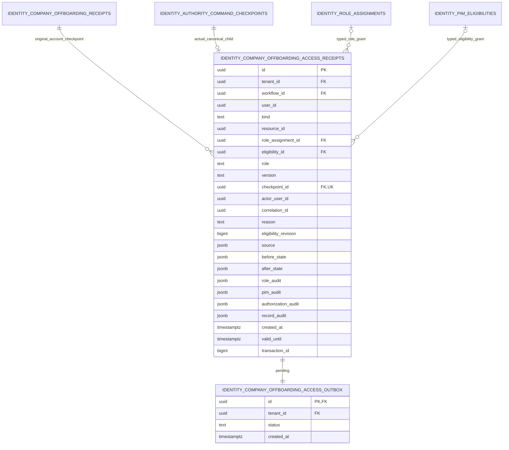

Identity besitzt alle dargestellten Daten. Genau einer der beiden typisierten Grant-FKs ist gesetzt und gleich `resource_id`, abhängig von `kind`; die optionale ERD-Kante bedeutet nicht, dass beide fehlen dürfen. Parent-FK verwendet Tenant/Vorgang, der kanonische Vertrag prüft zusätzlich Benutzer und negative Eligibility. Ein ursprünglicher Grant kann in diesem Parent höchstens eine Receipt besitzen. Historische Beziehungen und ursprüngliche Audits bleiben erhalten; die Rolle ist keine neue oder kopierte Berechtigungsquelle.

`identity_company_offboarding_access_checks(transaction_id,source,before_state)` ist ein interner Commit-Guard. Die retained Kette einschliesslich tatsächlicher Authority-Checkpoint-Events/-Outbox ist keine externe Erfolgsbestätigung. Keine Cross-DB-FKs, allgemeine Lösch-/Retention-Abnahme oder vollständige Leaver-Bereinigung. [Vertrag](../features/company-offboarding-access.md).

## Geräterückgabe: Device 006

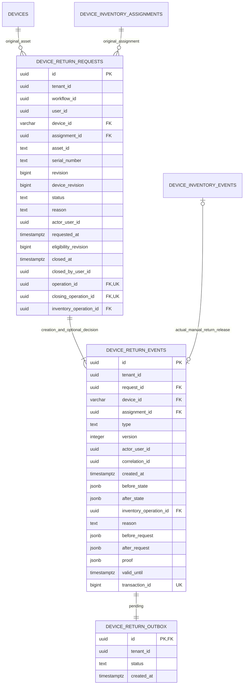

Alle dargestellten Relationen gehören Device. Ein Auftrag besitzt genau einen Erstellungs-Event, höchstens einen Abschluss-Event und reale Rückreferenz-FKs. Nur eine tatsächlich bestätigte Rückgabe referenziert den unveränderten 005-Release in derselben SQL-Transaktion. Normale Inventory-Events müssen keine Rückgabeentscheidung sein. Höchstens ein offener gespeicherter Auftrag pro ursprünglichem Assignment; alte abgebrochene Aufträge bleiben erhalten.

Tenant/Workflow/User aus Identity besitzen bewusst keinen datenbankübergreifenden FK. Deren ursprüngliche Herkunft wird als genau validierter 13-Feld-Snapshot unter ursprünglicher aktueller menschlicher Authority übernommen. `currentDeviceRevision` und `assignment_changed` sind echte aktuelle Projektionen, keine zweite aktive Geräte-/Assignment-Tabelle. Historische Rückgabe-Recovery darf keine spätere Zuweisung ändern. [Ausführbarer Vertrag und Grenzen](../features/device-returns.md).

## Eigene Blueprint-Entwürfe und immutable lokale Freigaben

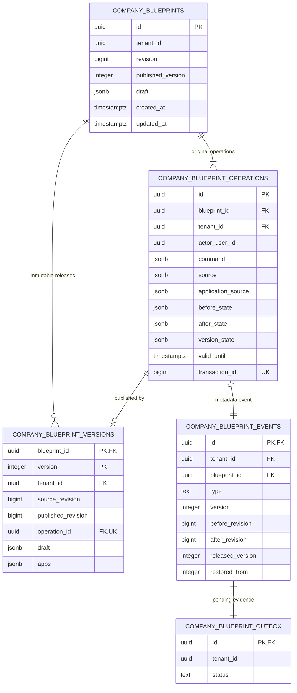

Alle dargestellten Relationen gehören Policy. Parent-FKs sind tenantgebunden; Blueprint-IDs werden nicht als globale Legacy-Blueprints übernommen. Die lokale Freigabe ist ein gespeichertes Artefakt, keine Deployment-Genehmigung. Entwurf und Freigabe besitzen begrenzte Konfigurationsdokumente, keine aktive Geräte- oder Lizenzprojektion. Gewünschte App-Pools werden unter ursprünglicher unabhängiger App-Authority gegen den tatsächlichen eigenen Katalog geprüft; Versionen halten historische Metadaten, keine dauerhaft gültige aktuelle Pool-Lease. Identity besitzt Tenant/Actor/Ownership separat. [Vertrag und offene Komposition](../features/company-blueprints.md).

## Firmen-Blueprint-Zuweisungen und Lizenzquellen: Migration 026/027

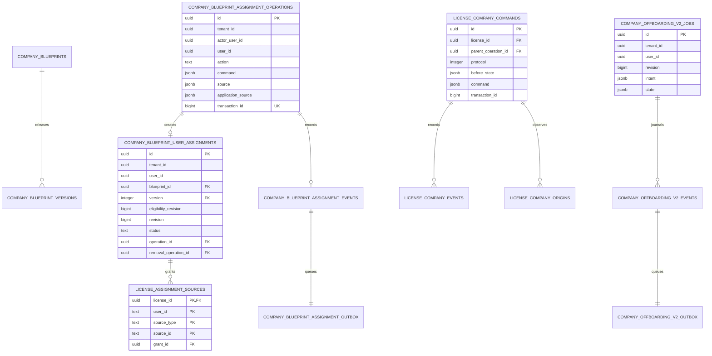

Die Zuweisungs-/Operations-/Event-/Outbox-Tabellen und V2-Workflowtabellen gehören Policy. Tenant/User-IDs bleiben kanonische Identity-IDs ohne Cross-DB-FKs. Eine effektive Seat-Zuordnung liegt weiterhin in `license_assignments`; mehrere manuelle/Blueprint-Quellen teilen diesen einen Sitz. Das Workflow-JSON hält ein vollständiges unveränderliches Quellen-/Binding-Manifest, einschliesslich app-freier Blueprints. Getrennte Datenbanktransaktionen von Identity und Policy werden nicht als atomar dargestellt. [Verhalten und Grenzen](../features/company-blueprint-assignments.md).

## Gruppenregeln: Identity 050

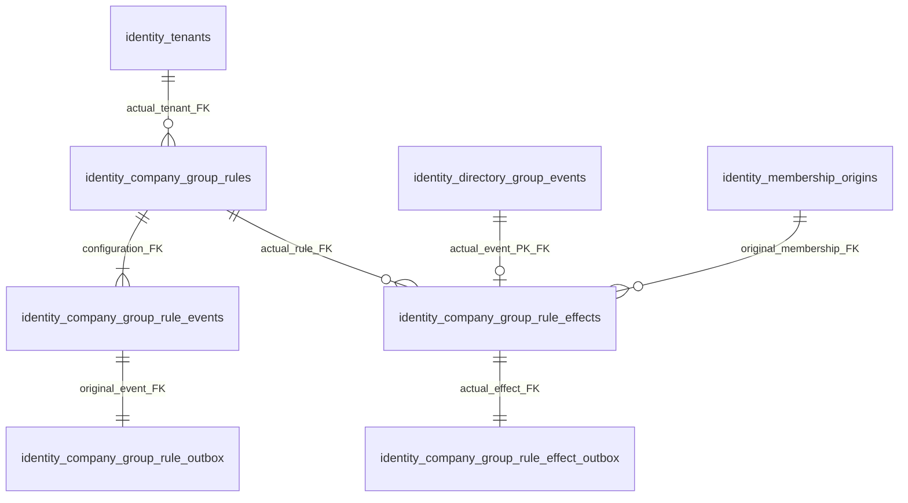

Alle dargestellten Tabellen gehören Identity. Die Konfiguration speichert keine zweite Membership-Liste. Der aktuelle Gruppenbezug wird über die tatsächliche eigene kanonische Gruppe geprüft; ein FK auf deren löschbare Zeile würde die retained Historie verhindern. Untergruppen-/Ausnahme-UUIDs sind begrenzte, bei der Konfiguration geprüfte Referenzen in JSONB, keine hier behaupteten relationalen FKs. Originalmanifest, Event-/Pending-Fingerprints und physische Commit-Guards sichern den beschriebenen Schreibweg. Konfiguration und einzelne Membership-Effekte committen getrennt; der ursprüngliche 050-Pfad ist manuell, der folgende 051-Pfad ergänzt App-Jobs. [Modell und Grenzen](domain-model.md#gruppenregeln-identity-050), [UI/API/CLI](../features/company-group-rules.md).

## App-Gruppenregeln: Identity 051

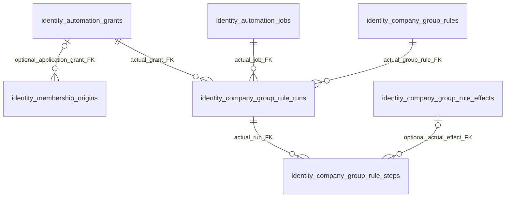

Alle dargestellten Tabellen gehören Identity. Job/Retry-Epoche/Zyklus und Run/User sind eindeutig. Die Work-Outbox ist über Original-Guards und Fingerprints an genau eine tatsächliche Run- oder Step-Zeile derselben Transaktion gebunden; sie hat keinen relationalen FK auf zwei unterschiedliche Tabellen. App-Origins behalten ihren echten Grant-FK und NULL als menschlichen Ersteller. Eine spätere tatsächliche Review-Entscheidung bleibt menschlich und unabhängig. [Teilmodell](domain-model.md#gruppenregeln-identity-050), [ausführbarer Ablauf und Grenzen](../features/company-group-rule-automation.md).

## App-Lizenzabgleich: Identity 049 und Policy 029

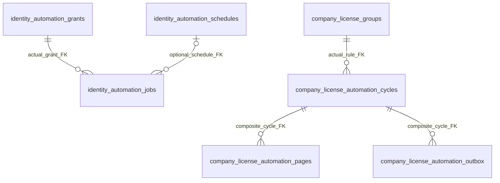

Die ersten drei Tabellen gehören Identity, die anderen Policy. Job-/Grant-/Tenant-IDs in einem Policy-Zyklus sind separat live gebundene Quellen, keine Cross-DB-FKs. Zyklus und Seiten sind je Job/Retry-Epoche/Zyklus und Seitenordinal eindeutig; Seite 0 der Pending-Outbox belegt die Erfassung. Seiten behalten echte geordnete Einzelresultate und Original-Actor/-Gruppenhash, nicht einen zweiten Sitzbestand. `identity_automation_jobs.progress` ist nur der bestätigte Fortschritt dieser getrennten Ausführung. [Modell und Grenzen](domain-model.md#appgebundener-lizenzabgleich-identity-049-und-policy-029), [ausführbarer Ablauf](../features/company-license-automation.md).

Identity 052 ergänzt keine Tabelle: Die [aktuelle Quellenprüfung](../features/company-group-live-sources.md) verwendet vorhandene Originalbelege, retained Revisionen und Review-Fristen. Snapshot-Quellenrevision und physischer Gruppen-ETag bleiben getrennt.
